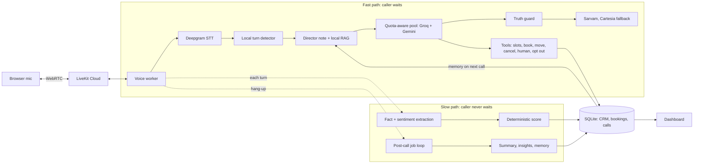

# Autonomous AI Sales Voice Agent

**One-page report:** [REPORT.md](REPORT.md) ([PDF](docs/Project_Report.pdf))

One common sales agent for any product. The **core** (`app/core.py`) holds how Aanya talks, sells and stays honest. A **product pack** (`products/*.json` + `.md`, or the creator in the Products tab) holds everything about one product. Each **lead** points to a product and carries its own notes.

| Common core | Product pack | Lead |
|---|---|---|
| Conversation style, objection handling, truth rules, tools, memory, sentiment, language | Company, offerings, prices, knowledge, qualifying facts and weights, appointment type, hosts, product rules | Name, phone, product, notes, memory, score |

Included: Skyline Realty (property) and BrightPath Academy (courses), both fictional.

## Run

1. Fill in `.env` (copy of `.env.example`): LiveKit, Deepgram, Google AI Studio, Groq, Sarvam.
2. Check keys: `.venv\Scripts\python scripts\check_keys.py`
3. Start: `powershell -ExecutionPolicy Bypass -File start.ps1`
4. Open http://localhost:8000 in Chrome. Use **Text chat** to save voice credit; **Start voice call** for the demo.
5. Tests (no keys needed): `.venv\Scripts\python -m pytest -q tests`

## Leads

Add one, or **Import** Excel, CSV or pasted rows (up to 5,000). Columns are matched automatically, every row is checked before saving, repeats and people who opted out are skipped, and rejected rows can be downloaded with reasons. Other columns become notes the agent can use.

The gear on a lead edits its name, phone, notes and do-not-call, or deletes it. **Select** deletes several. Deleting hides a lead and its calls from every list and report and can be undone; leads on a call or with an upcoming booking are kept. It is not erasure of personal data, which production would need.

## Calendar

Everything shown is set by the business or comes from real bookings. **Booking rules** (per product): days, start times, length, bookings allowed at the same time, how far ahead, least notice; defaults are labelled until saved. **Closures**: a day or time, for one or all products, with a reason. **Team**: people the business enters, starting empty; bookings stay unassigned until someone is chosen, and nobody can hold overlapping bookings across products. Outcomes: attended or no-show. The agent uses the same rules and never names a person unless one is assigned. Not built: working hours or leave per person, calendar sync, notifications.

## AI callers

A caller is a name, gender, voice, pace and personality, usable by any product. A product uses one caller or splits **new leads** by percentage; a lead keeps the same caller. Calls are credited to whoever made them, and bookings to the caller whose call won them (staff bookings to nobody; moves keep the credit). Products show results by caller and callers show results by product, with a warning below 20 leads each. Changing a caller's voice or personality mixes old and new results, so create a new caller to test a change.

## Reply speed

Measured on a real voice call (free tiers, 26 Nov 2026): English about 1.2 s end to end, Hindi and booking turns about 2.1 to 2.3 s; before, 2.4 to 9 s. What did it: a quota-aware pool of Groq models with Gemini as backup (Gemini first for Hindi), slots looked up and confirmations spoken by code instead of extra model calls, tools offered only when the customer's words call for them, and background work on a separate model. Time models again with `scripts/bench_models.py`.

## Insights

Counted by code across customers, never written by a model (`app/insights.py`): common objections and how many still booked, groups that book more or less often (with a Fisher exact test deciding between "unlikely to be chance alone" and "early sign"), facts the calls fail to learn, no-shows and handovers. Hidden until 10 customers have been spoken with; every insight opens to the customers behind it. Many groups are compared at once, so treat patterns as leads to test, not proof.

## Product reports

**Overview** and **Calls** share filters: AI caller, period, channel, language, result, lead quality. A filter selects calls; every number then covers only those calls, the people on them, and the bookings they led to. **Calls** lists each call with its result, length, mood and reply time, opens to the summary and transcript, and downloads as CSV. Language and lead quality are the lead's current values.

## Business problem

Enquiries go cold when nobody responds quickly, callers differ in language, and reps spend time on people who will not buy. The agent responds at once, and reps see only scored leads, confirmed visits and a next action.

## Architecture

### Conversation design (`app/agent.py`)

| Behaviour | How |
|---|---|
| No interrogation | `director_note()` counts consecutive questions and forbids a third in a row |
| Reads the mood | Background sentiment; if negative, selling stops for that turn |
| Never re-asks | Extracted facts are supplied every turn |
| Waits for you to finish | Local end-of-turn model, not just a silence timer |
| Interruptible | LiveKit barge-in; resumes after a false interruption |
| Quick | Instant greeting, streaming at every stage, early LLM start, CRM work off the fast path |
| Mirrors language | Detected every turn; voice language switches with it |
| Remembers | Post-call memory shapes the next greeting and conversation |

### Trust boundaries

- The LLM never computes the score, never chooses the lead, and can only book a slot it was offered in this call.
- "Booked" is returned only after a committed transaction. Unique indexes stop double booking.
- `app/guard.py` checks each sentence before it is spoken: claims of booking, moving, cancelling, opt-out or callback need a matching real action, and a confirmed day or time must match the booking. It is pattern-based, so unusual wording can slip through.
- Code, not the LLM, resolves dates and requires that the caller heard a slot before it is booked.
- Products are isolated: prompt, search index, slots and facts are per product. Figures of 1,000 or more must exist in that product's data before they are spoken (digits only; a price spelled in words is not checked).
- A pasted brief is stored verbatim as knowledge. The LLM only proposes settings, and offerings not named in the brief are dropped.
- `app/hedge.py` races a second model when the first is slow.
- Transcripts are treated as data in extraction prompts, and the UI renders text only.

## What is real and what is simulated

Real: voice pipeline, RAG, tools, scoring, booking transactions, memory, analysis, dashboard. Simulated: the business, its inventory and staff. CRM and calendar are local implementations of `CRMProvider` and `BookingProvider`; HubSpot or Google Calendar would be adapters. Phone (PSTN) calling is not built: LiveKit SIP plus an Indian carrier would be added, subject to TRAI/DLT requirements.

## Scaling to 1,00,000 users

Assume 3-minute calls over a 10-hour day, with a 3x peak.

| Scenario | Minutes | Average concurrent | Peak concurrent |
|---|---|---|---|
| 1 call per user per month, 20 working days | 3,00,000/month | 25 | 75 |
| Everyone in a single day | 3,00,000/day | 500 | 1,500 |

| Now | At scale |
|---|---|
| SQLite | Managed Postgres with pooling and read replica; row-level tenant isolation |
| In-process vectors | pgvector, one namespace per tenant |
| `calls` table as job queue | SQS/Redis Streams with dead-letter queue |
| One worker | Stateless worker pool autoscaled on active calls. At an assumed 20 calls per node, 1,500 calls = 75 nodes + 20% headroom = 90 (load test before committing) |
| One vendor each | Per-vendor concurrency budget, weighted routing, circuit breakers |
| Polling | WebSocket/SSE |

Vendor concurrency is the first bottleneck, so outbound calls are admitted through a queue with per-tenant limits. Deploy across two zones in an Indian region. Degrade in order: fallback vendor, text/SMS link, human callback.

## Cost

The prototype runs on free tiers: Rs 0. Commercially:

`cost/min = transport + agent compute + telephony + STT + LLM + TTS`

TTS is measurable: at Sarvam's listed Rs 3 per 1,000 characters (bulbul:v3) and roughly 400 agent characters a minute, about Rs 1.2/min. Take the other rates from vendors' current price pages on presentation day. Compute cost per **qualified visit**, not per minute: `cost per visit = cost/min x minutes per call / visit rate`. Example: at an assumed Rs 5/min, 3 minutes and an 8% visit rate, a visit costs about Rs 188. Pricing option: platform fee plus per-minute usage, or per qualified visit.

## Security and privacy

**Prompt safety** (`app/safety.py`): caller, product, lead and team text is checked when saved. Instant rules plus an AI reviewer look for attempts to collect secrets, override rules, hide being an AI, harass, leak data, promise or pressure. Blocks and warnings quote the exact words and say why; decisions are logged in `safety_log`. Imports use the rules only. If the reviewer is busy, the save needs confirming. Separately, every spoken sentence that asks for card, bank, OTP, PIN, password, Aadhaar or PAN details is replaced, whatever any prompt says. Both are pattern- and model-based, so they reduce risk rather than remove it.

**Stored data**: health, religion, caste, politics and sexuality are dropped from facts, memory and summaries; card, Aadhaar and OTP numbers are removed from transcripts. Transcripts otherwise keep what was said.

**Page**: state-changing requests must come from the dashboard's own origin; a strict Content-Security-Policy and related headers are set; API docs are off; customers' words are kept out of logs.

**Known and not fixed**: no login, Host header not restricted, no call or quota limits, LiveKit cloud recording, unencrypted databases and backups, deletion only hides, CDN script without integrity check.

In place: secrets server-side only, `.env` ignored by git, 15-minute room tokens scoped to one room, parameterised SQL, validated input, AI disclosure in the greeting, notice before calls, opt-out enforced by the API, server bound to localhost.

Before production: user login and roles (**there is none today**), HTTPS, encryption at rest, PII redaction, retention and deletion policy, audit log, rate limits, DPDP consent records and processor agreements. Free LLM tiers may use inputs for training, so **use synthetic data only**.

## Known limits

- The backup model can occasionally misstate a project detail. RAG lowers this risk; it does not remove it.
- Deepgram's multilingual mode covers Hindi and English among Indian languages. Others need Sarvam STT.
- Free-tier limits (requests/min, tokens/day) restrict this to one or two simultaneous demo calls.
- Conversation quality is prompt-driven and must be judged in live calls; automated tests cover logic, not charm.

## Live modification cheat sheet

| Ask | Where |
|---|---|
| Change scoring weights | Products tab, Edit, Qualifying questions (formula: `score()` in `app/crm.py`) |
| Add a tool | `@function_tool` method in `SalesAgent` |
| Track a new fact | Products tab, Edit, Add question |
| Change personality or voice | Callers tab (shared style: `CORE` in `app/core.py`) |
| Swap LLM | `build_llm()` in `app/agent.py` |
| Swap or tune voice | `.env` or `build_tts()` in `app/worker.py` |
| Faster/slower replies | `endpointing` in `app/worker.py` |
| Add knowledge | Products tab, Edit (no restart) |
| New product or industry | Products tab, New product. Files in `products/` are only loaded the first time |
| Change a product statistic | `for_product()` in `app/stats.py` |

## Five-minute demo

1. Choose Rahul, start a voice call. Say you have a new baby and your flat feels small.
2. Switch to Hindi mid-call; ask about a home loan. Interrupt an answer.
3. Say the price feels high and watch the mood change.
4. Ask to visit this weekend and pick a time. Show the booking, score and stage.
5. Hang up; show the summary and insight.
6. Call again: it greets you knowing the visit. Move it to another day.
