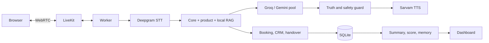

# Autonomous AI Sales Voice Agent: One-Page Project Report

**Problem.** Enquiries go cold when nobody responds quickly, customers switch between English and Hindi, and sales staff spend time on people who will not buy.

**Solution.** An AI caller that talks naturally, qualifies the lead, answers from company documents, books an appointment and leaves staff a scored lead, transcript and summary. One common core sells any product; each product is data, not code.

**Complete workflow (tested by voice).** Lead added or imported → AI call → qualification and document answers → customer picks a time → booking → summary and CRM update → next call remembers the customer and can move the booking.

| Requirement | How it is met |
|---|---|
| Real-time voice | LiveKit, streaming STT and TTS, interruptions, local end-of-turn detection |
| Memory and languages | Per-lead facts and call memory; English, Hindi and Hinglish, switching mid-call |
| Qualification and sentiment | AI extracts facts with a customer quote; code computes an explainable 0–100 score; per-turn sentiment steers tone |
| RAG | Local multilingual embeddings plus keywords, isolated per product |
| Booking and CRM | Own engine: limits checked inside transactions; code books a clear choice and speaks the confirmation. External CRM and calendar are adapter interfaces, not yet connected |
| Summaries and insights | Post-call job queue; insights are counted by code across customers, not written by AI |
| Management | Products, AI callers with A/B split, calendar, call reports, CSV/Excel import |

**What makes it trustworthy.** The AI proposes; code decides. A guard checks each spoken sentence, so claims of booking, opt-out or callback, and prices written in digits, must match real records. Text saved into prompts is screened with a reason given for every block, and requests for card or OTP details are stopped before they are spoken.

**Measured (free tiers, few calls).** Replies: about 1.2 s in English, 2.2 s in Hindi; a chosen time confirmed in 0.9 s. 267 automated tests. 12 prompt attacks before hardening: 11 resisted; the one that worked was fixed and retested.

**Scale to 1,00,000 users.** At 3 minutes a call over 10 hours: one call per user per month averages 25 concurrent calls (75 peak); everyone in one day averages 500 (1,500 peak). Path: stateless autoscaled workers, Postgres with pgvector, a managed queue, vendor routing with per-tenant limits. Not load-tested.

**Cost and commercial case.** Prototype: ₹0 on free tiers. At scale: transport + telephony + STT + LLM + TTS per minute; TTS alone is about ₹1.2/min at Sarvam's listed price. Sold as a platform fee plus usage, or per qualified visit. At an assumed ₹5/min, 3-minute calls and an 8% visit rate, one visit costs about ₹188.

**Deployment.** Runs locally with one script today. Production: containers in an Indian region across two zones, HTTPS and managed secrets.

**Known limits.** No login, phone (PSTN) calling or customer notifications; LiveKit recording must be switched off in its dashboard; databases are unencrypted and deletion only hides; free quotas limit this to a demo; Hindi is less polished than English. Businesses and leads are fictional.

**Stack.** Python, LiveKit Agents, FastAPI, SQLite, fastembed, plain JavaScript; Deepgram, Groq, Gemini, Sarvam. Built with AI-assisted development tools. Setup and details: [README](README.md).
